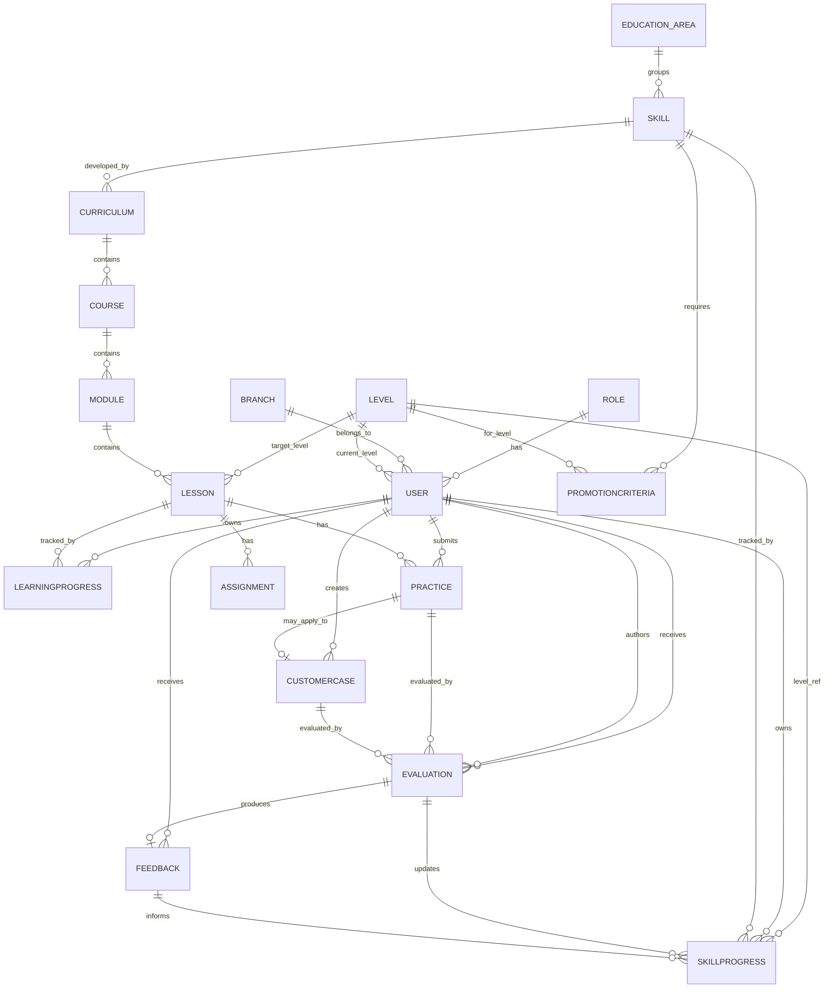

# DATA_MODEL — Entity · 관계 · 필드

> 개발 순서상 **Data → Relationship** 단계. UI보다 먼저 확정한다.
> 원칙: 콘텐츠·Level·평가기준은 데이터로 관리(하드코딩 금지). Skill은 다차원. 6개 축 분리.

---

## 1. Entity 목록

핵심 Entity (spec §7):

```
User · Role · Branch · Level · Skill · Curriculum · Course · Module · Lesson ·
Assignment · Practice · Evaluation · Feedback · CustomerCase ·
LearningProgress · SkillProgress · PromotionCriteria
```

역할별 분류:

| 그룹 | Entity |
|------|--------|
| 조직/사람 | User, Role, Branch |
| 성장 축(기준) | Level, Skill |
| 콘텐츠 계층 | Curriculum, Course, Module, Lesson, Assignment |
| 활동 기록(6축) | LearningProgress, Practice, CustomerCase, Evaluation, Feedback, SkillProgress |
| 승급 | PromotionCriteria |

---

## 2. ERD (관계 개요)



### 핵심 관계 (spec §7 — 반드시 유지)
```
User → SkillProgress → LearningProgress → Practice → CustomerCase
     → Evaluation → Feedback → Skill Growth
```
이 사슬이 데이터에서 **끊기지 않아야** 한다. 각 활동은 원인이 되는 활동을 참조로 연결한다.

---

## 3. Entity 상세

표기: `PK` 기본키, `FK` 외래키, `?` nullable, `[MVP]` MVP 필수, `[later]` 구조만.

### 3.1 User `[MVP]`
| 필드 | 타입 | 설명 |
|------|------|------|
| id `PK` | uuid | |
| name | string | |
| email | string(unique) | 로그인 |
| password_hash | string | |
| role_id `FK` | → Role | |
| branch_id `FK?` | → Branch | |
| level_id `FK?` | → Level | 현재 전체 성장 단계 |
| is_active | bool | |
| is_seed | bool | 시드/실데이터 분리 |
| created_at / updated_at | datetime | |

### 3.2 Role `[MVP]`
| 필드 | 타입 | 설명 |
|------|------|------|
| id `PK` | uuid | |
| key | enum-ish string | `designer` / `leader` / `educator` / `admin` |
| name | string | 표시명 |
| permissions | json | 권한 조합 (확장 가능) |

> Role은 데이터로 관리. 권한을 코드 상수로 고정하지 않는다.

### 3.3 Branch `[MVP]`
| id `PK` | name | region? | is_active |
매장/지점.

### 3.4 Level `[MVP]` — 하드코딩 금지
| 필드 | 타입 | 설명 |
|------|------|------|
| id `PK` | uuid | |
| order | int | 01~06 순서 |
| code | string | `FOUNDATION` 등 |
| name | string | 표시명 (변경 가능) |
| description | text? | 기준 설명 |
| criteria | json? | 이 Level 도달 기준(운영 조정용) |

### 3.5 EducationArea `[MVP]`
| id `PK` | name | order |
교육 영역(디자인/상담/판매/…). Skill의 상위 묶음.

### 3.6 Skill `[MVP]` — 다차원 (점수 하나 아님)
정의(카탈로그) 테이블. 사용자별 상태는 SkillProgress에 있다.
| 필드 | 타입 | 설명 |
|------|------|------|
| id `PK` | uuid | |
| education_area_id `FK` | → EducationArea | |
| name | string | 얼굴 분석, 디자인 연결 … |
| is_core | bool | 진단→디자인 연결 등 핵심 표시 |
| order | int | |

### 3.7 SkillProgress `[MVP]` — 성장 축의 중심
사용자 × Skill 의 성장 상태.
| 필드 | 타입 | 설명 |
|------|------|------|
| id `PK` | uuid | |
| user_id `FK` | → User | |
| skill_id `FK` | → Skill | |
| current_level_id `FK` | → Level | 현재 역량 단계 |
| target_level_id `FK?` | → Level | 목표 단계 |
| practice_count | int | 실습 횟수 |
| application_count | int | 고객 적용 횟수 |
| evaluation_count | int | 평가 횟수 |
| feedback_count | int | 피드백 횟수 |
| growth_history | json/table | 성장 이력 (아래 §4) |
| updated_at | datetime | |

> **완료율(LearningProgress)은 여기 들어오지 않는다.** 성장은 실습·적용·평가·피드백의 결과.

### 3.8 Curriculum / Course / Module `[MVP]` — 콘텐츠 계층
공통 필드: `id PK`, `title`, `description?`, `order`, `is_active`, `is_seed`.
- **Curriculum**: `skill_id FK`(주로 어떤 Skill을 키우나), `target_level_id FK?`.
- **Course**: `curriculum_id FK`.
- **Module**: `course_id FK`.

### 3.9 Lesson `[MVP]`
| 필드 | 타입 | 설명 |
|------|------|------|
| id `PK` | uuid | |
| module_id `FK` | → Module | |
| title | string | |
| content | rich text/json | 교육 내용 (DB에 저장, 하드코딩 금지) |
| order | int | 순서 (관리자 편집) |
| is_required | bool | 필수/선택 |
| target_level_id `FK?` | → Level | 대상 Level |
| estimated_minutes? | int | |
| is_active / is_seed | bool | |

### 3.10 Assignment `[MVP]`
Lesson에 붙는 과제 정의. `id`, `lesson_id FK`, `title`, `instructions`, `type`(read/quiz/task), `order`.

### 3.11 LearningProgress `[MVP]` — 축1: 배웠다 (완료율)
| 필드 | 타입 | 설명 |
|------|------|------|
| id `PK` | uuid | |
| user_id `FK` | → User | |
| lesson_id `FK` | → Lesson | |
| status | enum | `not_started` / `in_progress` / `completed` |
| progress_pct | int | 0~100 |
| started_at? / completed_at? | datetime | |

> 이 테이블은 "완료"의 근거일 뿐. **성장 지표로 쓰지 않는다.**

### 3.12 Practice `[MVP]` — 축2: 연습했다
| 필드 | 타입 | 설명 |
|------|------|------|
| id `PK` | uuid | |
| user_id `FK` | → User | |
| lesson_id `FK?` | → Lesson | 어떤 레슨의 실습인가 |
| assignment_id `FK?` | → Assignment | |
| skill_id `FK?` | → Skill | 어떤 역량 실습 |
| customer_case_id `FK?` | → CustomerCase | 실제 고객에 적용했다면 연결(축3로 승격) |
| submission | text/json | 제출 내용 |
| status | enum | `submitted` / `reviewed` |
| created_at | datetime | |

### 3.13 CustomerCase `[later, 구조만]` — 축3: 고객에 적용했다
장기적으로 가장 중요한 데이터. **개인정보 최소 저장.**
| 필드 | 타입 | 설명 |
|------|------|------|
| id `PK` | uuid | |
| designer_id `FK` | → User | |
| skill_id `FK?` | → Skill | |
| customer_alias | string? | 익명/최소 식별 (실명·연락처 저장 안 함) |
| customer_need | text? | 고객 니즈 |
| current_state | text? | 현재 상태 |
| observation | text? | 관찰 |
| diagnosis | text? | 진단 |
| problem_definition | text? | 문제 정의 |
| image_direction | text? | 이미지 방향 |
| design_strategy | text? | 디자인 전략 |
| design_elements | text? | 디자인 요소 |
| procedure | text? | 시술 |
| before_ref / after_ref | media ref? | Before/After (참조만) |
| result | text? | 결과 |
| education_point | text? | 교육 포인트 |
| created_at | datetime | |

> 필드는 교육 사고 구조(관찰→진단→…→결과)와 1:1 매핑. 평가·피드백은 Evaluation/Feedback로 연결.

### 3.14 Evaluation `[MVP]` — 축4: 평가받았다
사람(행동·역량)을 아니라 **행동·역량**을 평가.
| 필드 | 타입 | 설명 |
|------|------|------|
| id `PK` | uuid | |
| subject_user_id `FK` | → User | 평가 대상 디자이너 |
| evaluator_id `FK` | → User | 평가자(Leader/Educator) |
| skill_id `FK?` | → Skill | 어떤 역량 |
| practice_id `FK?` | → Practice | 대상 실습 |
| customer_case_id `FK?` | → CustomerCase | 대상 케이스 |
| criteria | text/json | Criteria |
| observation | text | Observation |
| strength | text | Strength |
| gap | text | Gap |
| next_action | text | Next Action (→ Feedback로 연결) |
| score | int? | 선택 — 단독 성장 대표 금지 |
| status | enum | `pending` / `completed` |
| created_at | datetime | |

> `pending`은 Admin Home "평가 대기"에 노출.

### 3.15 Feedback `[MVP]` — 축5: 피드백받았다
| 필드 | 타입 | 설명 |
|------|------|------|
| id `PK` | uuid | |
| evaluation_id `FK?` | → Evaluation | 근거 평가 |
| subject_user_id `FK` | → User | 대상 |
| author_id `FK` | → User | 작성자 |
| skill_id `FK?` | → Skill | |
| message | text | 피드백 본문 |
| next_action | text | 다음 행동 (필수 지향) |
| acknowledged_at? | datetime | 디자이너 확인 시각 |
| created_at | datetime | |

> 피드백은 항상 next_action으로 연결. Designer Home FEEDBACK에 노출.

### 3.16 PromotionCriteria `[later, 구조만]` — 승급 기준
승급을 **자동 결정하지 않는다.** 사람의 판단을 돕는 기준 저장소.
| 필드 | 타입 | 설명 |
|------|------|------|
| id `PK` | uuid | |
| from_level_id `FK` | → Level | |
| to_level_id `FK` | → Level | |
| skill_requirements | json | Skill별 요구 (예: 디자인연결 ≥ L3, application_count ≥ N) |
| notes | text? | |

> 이 기준으로 "승급 가능자 후보"를 계산해 Admin에 **표시만** 한다. 결정은 사람.

---

## 4. growth_history (성장 이력) 구조

SkillProgress의 변화를 추적. 별도 테이블 권장.

`SkillGrowthEvent`
| 필드 | 타입 | 설명 |
|------|------|------|
| id `PK` | uuid | |
| skill_progress_id `FK` | → SkillProgress | |
| from_level_id `FK?` | → Level | |
| to_level_id `FK?` | → Level | |
| cause_type | enum | `evaluation` / `feedback` / `application` / `practice` |
| cause_id | uuid? | 근거 레코드 참조 |
| note | text? | |
| created_at | datetime | |

> **성장의 근거를 남긴다.** "완료해서 올랐다"는 근거는 존재하지 않는다(완료만으로 상승 불가).

---

## 5. 6개 축 ↔ 테이블 매핑 (불변식)

| 축 | 테이블 | 절대 규칙 |
|----|--------|-----------|
| Learning | LearningProgress | 완료율. 성장 아님 |
| Practice | Practice | 연습 기록 |
| Application | CustomerCase (+Practice.customer_case_id) | 고객 적용 증거 |
| Evaluation | Evaluation | 행동·역량 평가 |
| Feedback | Feedback | next_action 필수 지향 |
| Skill Growth | SkillProgress + SkillGrowthEvent | 위 축들의 결과로만 상승 |

---

## 6. 설계 불변식 (마이그레이션/코드 리뷰 체크리스트)

- [ ] Level 명칭·순서·기준이 코드 상수가 아니라 `Level` 테이블에 있다.
- [ ] Lesson.content 등 콘텐츠가 DB에 있다 (하드코딩 없음).
- [ ] SkillProgress에 완료율 필드가 없다 (완료율은 LearningProgress 전용).
- [ ] Skill 상태가 단일 점수가 아니라 다차원(count들 + level + history)이다.
- [ ] Evaluation이 Criteria/Observation/Strength/Gap/Next Action(/Score)을 갖는다.
- [ ] CustomerCase가 교육 사고 구조 필드를 갖고 PII 최소화한다.
- [ ] 모든 활동 레코드에 `is_seed`(또는 환경 분리)가 있어 실데이터와 안 섞인다.
- [ ] PromotionCriteria는 표시용이며 자동 승급 코드가 없다.
- [ ] 핵심 사슬(User→SkillProgress→…→Feedback→Growth)의 FK가 연결돼 있다.

---

## 7. 명명/기술 메모 (제안)

- ORM: Prisma. `schema.prisma`를 데이터 모델의 single source of truth로.
- DB: PostgreSQL (로컬 Docker 또는 Supabase).
- 시드: `database/seed/` 아래, `is_seed=true`로만 삽입. 실데이터와 물리/논리 분리.
- json 필드(permissions, criteria, skill_requirements)는 운영 유연성 위해 채택하되,
  자주 질의되는 축(count, level)은 정규 컬럼으로 유지.
